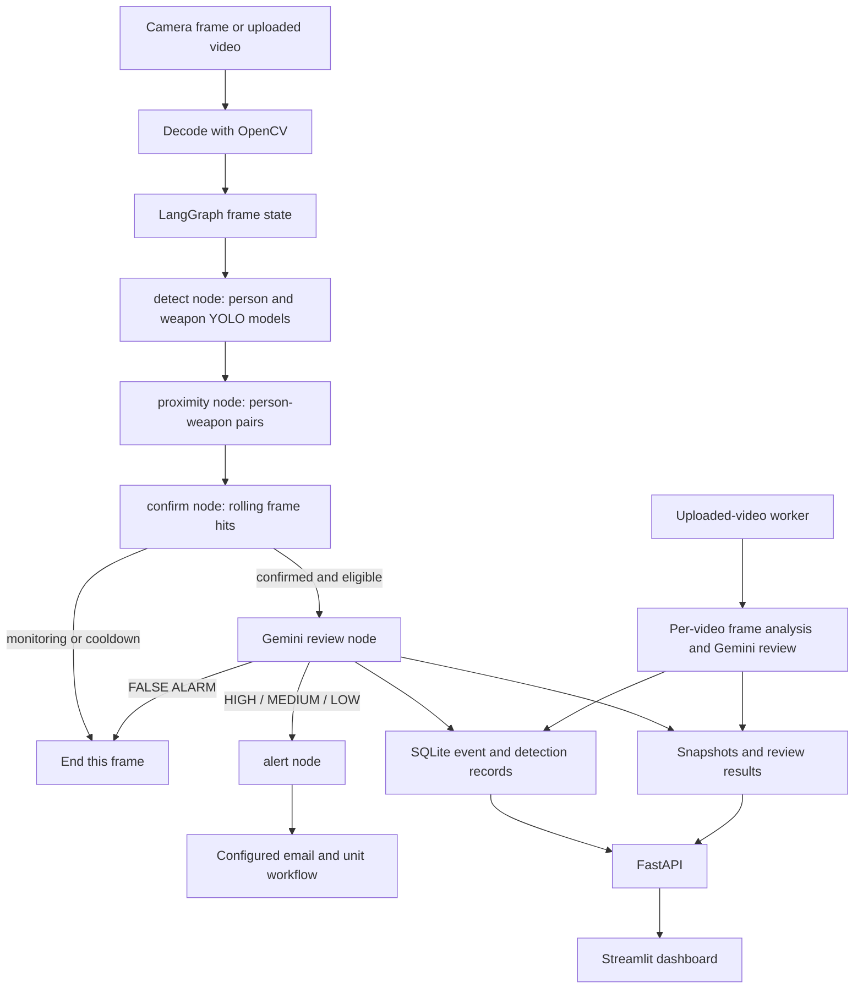
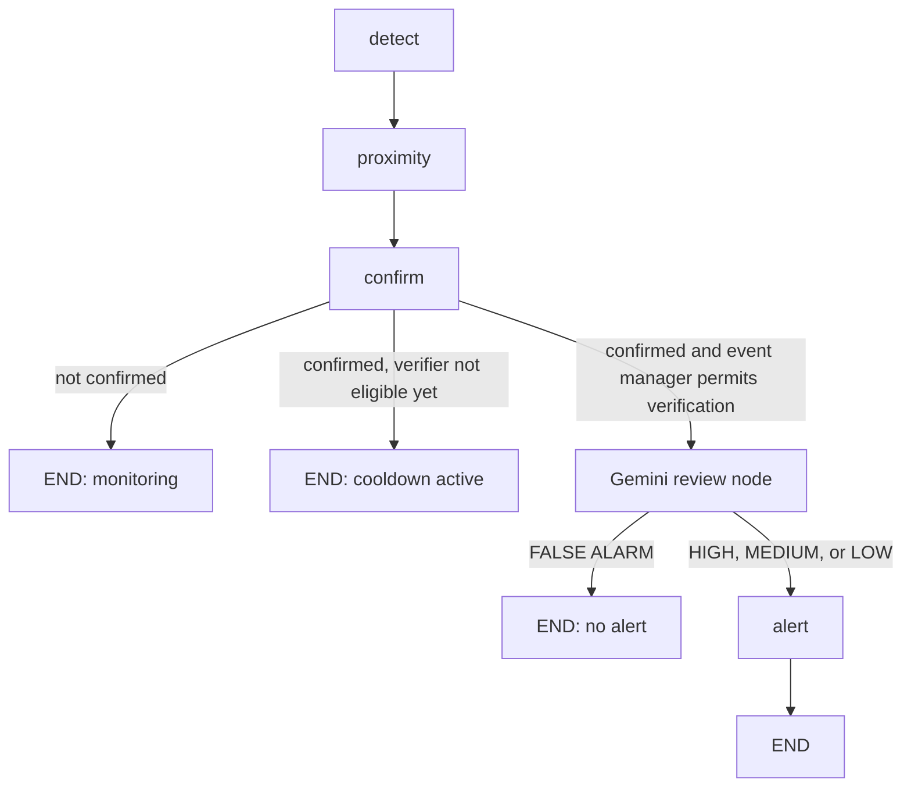

# STRIX: Deep learning based Intelligent Weapon Detection and Incident Response System

## 1. Document purpose

This document describes the current STRIX implementation, its data and model pipeline, runtime decisions, interfaces, persistence, and evaluation evidence. It is based on the project source code and artifacts.

## 2. Project overview

STRIX is a weapon detection, alerting and monitoring system that processes live camera frames, replayed video, and uploaded videos. Its live and replay runtime is orchestrated by a LangGraph stateful agent: graph nodes perform detection, person-weapon association, temporal confirmation, Gemini scene review, and alert handling. YOLOv8 and YOLOv11 object detection models identify people, guns, and knives. Uploaded-video analysis uses an isolated frame-processing worker with the same detection and confirmation rules and Gemini review. Results are retained in SQLite and analysis files and are displayed through a Streamlit dashboard backed by a FastAPI service.

The LangGraph workflow assists a human operator by passing a typed frame state through specialized perception and response nodes. It combines visual detection, spatial context, temporal persistence, and Gemini's contextual interpretation before the notification node handles an accepted severity.

## 3. Objectives

1. Detect person, gun, and knife candidates in live camera streams and uploaded videos.
2. Filter weak detections using class-specific confidence thresholds.
3. Associate weapon candidates with nearby people using bounding-box geometry.
4. Require temporal persistence before creating a confirmation episode.
5. Provide Gemini with visual evidence for contextual review.
6. Save events, snapshots, annotated videos, scores, and review output.
7. Display results in a browser dashboard and support configured email/unit workflows.
8. Keep model evidence, configuration, and limitations traceable.

## 4. Scope and boundaries

The current system is a final-year project prototype for surveillance assistance, demonstrations, and evaluation. It focuses on candidate weapon detection, person context, event confirmation, semantic review, evidence storage, and notification workflow. Tracker IDs provide frame-to-frame object continuity, while Gemini supplies the contextual severity interpretation.

## 5. System architecture



### Main modules

| Module | Responsibility |
|---|---|
| `app/detection.py` | Loads models, runs inference, filters detections, and creates display labels. |
| `app/proximity.py` | Computes box centres, Euclidean distance, IoU, nearest-person association, and valid pair status. |
| `app/tracker.py` | Maintains separate person and weapon box tracks with greedy IoU matching. |
| `app/graph.py` | Builds and compiles the LangGraph agent for live/replay frames, coordinating detection, tracking, confirmation, Gemini review, snapshots, records, and notifications. |
| `app/event_manager.py` | Controls live event state, verification eligibility, timeout, cooldown, and snapshot hooks. |
| Gemini verification module | Sends prepared visual evidence to the configured Gemini model and parses its structured severity response. |
| `app/video_analysis.py` | Processes uploaded videos and saves annotated output, score history, thumbnails, snapshots, and results. |
| `app/api/server.py` | FastAPI routes for health, live feed, events, videos, units, assignments, and email records. |
| `app/dashboard/dashboard.py` | Streamlit interface for live status, events, video analyses, mails, and control functions. |
| `app/database.py` | SQLAlchemy models and SQLite persistence. |
| `app/alert.py` | SMTP email dispatch and unit dispatch handling. |

### LangGraph workflow and nodes

Live camera and replay frame processing is assembled in `app/graph.py` as a LangGraph `StateGraph` over the typed `STRIXState`. The graph is compiled once by the runtime and invoked once for each frame. Each invocation passes partial state updates from node to node; shared trackers, the rolling confirmer, and event manager preserve their runtime history between invocations. This makes the graph a stateful, node-based agent workflow rather than a single monolithic frame handler.




| Graph stage | Work performed | State fields returned / effects |
|---|---|---|
| `detect` (`detection_node`) | Runs person and weapon inference; normalizes missing results to empty lists; updates the person and weapon trackers on every frame, including frames with no detections. | Returns `persons` and `weapons`. Trackers maintain their own state outside the LangGraph frame state. |
| `proximity` (`proximity_node`) | Finds each weapon's nearest person and retains pairs passing the configured distance OR IoU gate. Selects the maximum pair threat score. | Returns `pairs` and `current_score`; the score is weapon confidence for the best valid pair, or zero when no valid pair exists. |
| `confirm` (`confirmation_node`) | Checks whether any valid pair clears its class-specific confidence threshold, then updates the shared six-frame rolling confirmer with this hit or miss. | Returns `confirmed`, `avg_score`, and `status`. Confirmation requires at least four hits in the latest six processed frames. |
| Gemini review stage | Saves an event snapshot when applicable; asks Gemini to assess the best valid pair; records a detection for accepted HIGH/MEDIUM/LOW outcomes; stores the review result in the event manager. Verification exceptions are converted to a `FALSE ALARM` result. | Returns the verification decision, reasoning, and status; may write snapshot and database records. |
| `alert` (`alert_node`) | Checks event alert eligibility and sends the configured notification for an accepted severity. | Returns the delivery status and records the alert result through the event manager. |

`STRIXState` carries the current `frame`, `persons`, `weapons`, `pairs`, `current_score`, rolling `avg_score`, `confirmed` flag, user-facing `status`, and Gemini decision/reasoning. LangGraph nodes return partial state updates; the compiled graph passes those values to subsequent nodes. Detection models, trackers, confirmer, Gemini verifier, alerter, and event manager are module-level components in `app/graph.py`, so the rolling history and event/cooldown state persist across successive frames in the running process.

Routing after `confirm` is conditional. An unconfirmed frame ends the graph after updating rolling confirmation. A confirmed frame is sent to the Gemini review node only when the event manager permits verification; a confirmation that falls within the verification cooldown also ends that frame's graph run. After Gemini, `FALSE ALARM` ends without alerting; `HIGH`, `MEDIUM`, and `LOW` continue to `alert`, which applies its own event-level alert eligibility check. The event manager handles event creation, timeout, verification cooldown, and event persistence alongside this node flow.

## 6. Image-frame processing pipeline

### 6.1 Frame acquisition

For live operation, OpenCV captures frames from the configured camera index. For replay, `app/main.py` can read a video file. For browser upload, the API validates the file type and size and `app/video_analysis.py` decodes frames with OpenCV. The upload limit is 100 MB and the analysis path caps processing at 18,000 frames. If the source FPS is invalid, the video analyzer uses 30 FPS as a fallback.

### 6.2 Frame preparation and preprocessing

The current code passes decoded OpenCV frames to the Ultralytics model interface. The model library performs standard inference preparation, including conversion and resizing/letterboxing appropriate to the configured model input. Training uses the recorded Ultralytics configuration and dataset labels.

The Gemini evidence image follows a separate preparation path: the largest image dimension is reduced to at most 640 pixels, the image is encoded as JPEG at quality 40, and the JPEG is passed as a base64 data URL. This reduces request size and latency but can remove small visual details.

### 6.3 Detector inference

The current separate-model runtime uses:

| Role | File | Class handling | Runtime confidence filter |
|---|---|---|---:|
| Person | `app/yolov8n.pt` | YOLO class 0 (`person`) | 0.70 |
| Gun | `models/gun_best.pt` | Gun-model detections displayed as `Gun` | 0.70 |
| Knife | `models/wuhp_guns_100_11m_candidate.pt` | Class whose model name is `knife`, case-insensitive | 0.40 |

The detector returns bounding boxes, class information, and confidence scores. Detections below their class filter are discarded before pairing and downstream confirmation. The implementation supports the available Ultralytics/PyTorch runtime device, including GPU execution when CUDA is configured.

### 6.4 Overlay output

The live and video-analysis overlays show object class, confidence, and temporary tracker ID where available. A displayed ID identifies a tracked box within one process or video analysis. It is not a person identity and is not expected to remain the same across separate runs.

## 7. Person-weapon association

For every surviving weapon detection, the system selects the nearest surviving person by Euclidean distance between bounding-box centres.

For boxes `B_w` and `B_p`:

```text
distance = sqrt((x_w - x_p)^2 + (y_w - y_p)^2)
IoU      = area(B_w intersection B_p) / area(B_w union B_p)
```

A weapon-person pair is accepted when:

```text
centre distance <= 400 pixels OR IoU >= 0.10
```

The condition is an OR condition. IoU is intersection over union, while centre distance captures closeness when one box is small relative to the other. Together, these measures provide a practical person-weapon context gate for surveillance frames.

## 8. Frame score and temporal confirmation

### 8.1 Frame score

Geometry decides whether a pair is eligible. It does not add a weighted proximity or overlap term to the score. For valid pairs, the frame score is the weapon detector confidence:

```text
frame_score = maximum weapon confidence among valid person-weapon pairs
frame_score = 0 when no valid pair exists
```

A frame is a hit when a valid person-weapon pair exists and the weapon confidence clears the relevant class threshold. The current hit thresholds are 0.70 for guns and 0.40 for knives.

### 8.2 Trackers

Person and weapon objects use separate `SimpleTracker` instances. Matching is greedy and uses IoU of at least 0.30. An unmatched detection receives a new ID. A track is removed after more than five missed processed frames. The tracker updates on empty frames as well as detection frames.

Tracking consistency is calculated as:

```text
tracking_consistency = number_of_hits / track_age
```

It is retained as contextual information but is not part of the current frame score or four-of-six confirmation rule.

### 8.3 Rolling confirmation

The confirmer stores the latest six processed-frame states. Confirmation occurs when at least four of those states are hits:

```text
confirmed when count(hit states in latest six frames) >= 4
```

The hits do not need to be consecutive. Up to two misses or invalid-pair frames can occur inside a full six-frame window. The first possible decision is after four processed frames if all four are hits. A displayed rolling average is informational; it is not the confirmation criterion.

The current confirmer is shared at event level rather than maintained independently for every weapon track. Therefore, qualifying hits from relevant person-weapon pairs can contribute to the same rolling window. This supports identifying a sustained weapon-related situation for review, including scenes containing more than one person or weapon.

## 9. Gemini verification

The Gemini review node uses `ChatGoogleGenerativeAI` with model ID `gemini-3.1-flash-lite`. It is the semantic interpretation stage of the live LangGraph workflow: the preceding nodes establish detector evidence, valid person-weapon context, and temporal confirmation; Gemini then evaluates the submitted image and evidence before routing to either an alert or a no-alert end state.

The prompt requests that Gemini:

- decide whether the visible object appears to be a weapon;
- describe the apparent type, such as handgun, rifle, or knife, only when the image supports that description;
- describe whether the object appears associated with a person;
- assess visible proximity and scene context;
- consider false-positive explanations;
- return exactly:

```text
LEVEL: <HIGH | MEDIUM | LOW | FALSE ALARM>
REASONING: <short explanation>
```

Gemini’s level complements detector confidence with scene context. Malformed output and provider errors default to `FALSE ALARM` with an explanation. The configured provider request timeout is 2,000 ms with no retries.

## 10. Live LangGraph agent run

The camera loop reads a frame and invokes the compiled LangGraph with an initial `STRIXState`. The graph then executes `detect` → `proximity` → `confirm`. The conditional router either ends that frame's run in monitoring/cooldown or sends it to the Gemini review node. A non-false-alarm Gemini result routes to `alert`; the `alert` node applies event-level eligibility before dispatching the configured notification. Snapshot and database writes happen at their corresponding event/review stages.

The `detect`, `proximity`, `confirm`, Gemini review, and `alert` nodes perform the agent's frame-level work. The event manager and trackers are stateful collaborators called by these nodes; they are not separate LangGraph nodes. After the graph returns, the camera loop draws the overlay, publishes the live frame, and reads the next frame for a new graph invocation.

The event manager currently uses a five-second event timeout and a 60-second cooldown. These are event-lifecycle controls and are separate from the detector confidence thresholds.

## 11. Uploaded-video analysis workflow

The dashboard accepts MP4, MOV, AVI, MKV, and WEBM files up to 100 MB. Each analysis receives independent tracker and confirmer state; it does not reuse webcam IDs or state. This path is a dedicated sequential video-analysis worker, not the live LangGraph invocation loop; it reuses the detector, pairing and confirmation logic, and Gemini verifier to produce a per-video result.

The worker:

1. creates a persistent analysis directory;
2. decodes frames and runs the same detector, association, tracking, and four-of-six logic;
3. writes an annotated video;
4. stores score history as JSON;
5. saves a thumbnail;
6. saves snapshots for confirmation episodes;
7. requests Gemini review for confirmed segments;
8. stores the final result JSON;
9. exposes the saved analysis through the API and dashboard.

Video analysis is serialized by a lock. The browser-compatible output is generated as H.264 MP4 using FFmpeg where available. Uploaded-video analysis stores results but does not use the live event email dispatch path.

## 12. Dashboard and API

The Streamlit dashboard contains these functional areas:

| Area | Function |
|---|---|
| Home | Live feed, service state, and recent event overview. |
| Events | Event list, event details, snapshots, confidence, tracker information, and Gemini result. |
| Video Analysis | Upload files, browse saved analysis cards with thumbnails, open annotated results, inspect snapshots/scores, and delete selected analyses. |
| Mails | View messages addressed to the main recipient and assigned units, including recipient and workflow status. |
| Control Panel | Manage units, assignments, and exposed operational settings. |

FastAPI provides route groups for health/live feed, events, video analyses, annotated files, thumbnails, snapshots, units, assignments, and email records. The route implementation is defined in `app/api/server.py`.

Browser audio alerts are enabled through the dashboard interaction flow. SMTP dispatch records the recipient and workflow status, while unit assignments are visible in the Mails section for operational follow-up.

## 13. Persistence and data model

The application uses SQLite at `app/data/strix.db` through SQLAlchemy.

| Entity/file area | Purpose |
|---|---|
| `ThreatEvent` | Live event lifecycle, timestamps, status, and summary. |
| `DetectionRecord` | Class, confidence, box, tracker ID, consistency, and event association. |
| `Unit` | Configured response unit and contact data. |
| `UnitAssignment` | Event-to-unit assignment and dispatch workflow status. |
| `AppSetting` | Persisted settings used by supported features. |
| `app/data/video_analyses` | Uploaded-analysis JSON, annotated video, thumbnail, score history, and snapshots. |

Video clips, snapshots, and incident notes can contain sensitive information. The current project stores them locally; deployment should define access control, retention, backup, deletion, and privacy procedures.

## 14. Datasets and model-development evidence

### Gun dataset

`Gun with webcam views.v1i.yolov8` contains one `Guns` class with YOLO bounding-box labels:

- training: 10,764 images;
- validation: 240 images;
- test: 240 images;
- total: 11,244 images.

The dataset is attributed to Roboflow Universe and declares CC BY 4.0. The deployed `models/gun_best.pt` checkpoint was evaluated using the labelled test split described below.

### Knife dataset and detector

The local synthetic CCTV-style knife material contains 114 images, with saved path lists showing 91 training images and 23 validation images. `results.zip` contains experiment artifacts and path lists rather than a complete separate 94-image original set. The local README identifies a Simuletic source and CC BY 4.0.

The current knife detector is the integrated YOLO11 model `models/wuhp_guns_100_11m_candidate.pt`. It is evaluated using the labelled knife validation split described above. The same checkpoint is used for live and uploaded-video inference.

### Manual negatives

The `Manual Negatives` directory contains 33 JPG files without paired annotation files. It is maintained as an additional hard-negative collection for future dataset refinement. For object detection, negative images are incorporated through valid empty label files and an explicit training-split entry.

## 15. Evaluation and metrics

### Metric definitions

For matched object detections:

```text
Precision = TP / (TP + FP)
Recall    = TP / (TP + FN)
F1        = 2 * Precision * Recall / (Precision + Recall)
```

mAP summarizes precision-recall performance over classes and IoU conditions. Metrics depend on the dataset, split, label quality, class mapping, confidence threshold, and matching protocol.

### YOLO11 knife validation evaluation

The integrated YOLO11 knife model was evaluated with Ultralytics 8.4.183 on the 23-image labelled validation split, containing 44 labelled instances, at 640-pixel inference size and batch size 8. The model’s native classes are `Gun` and `Knife`; the knife-class results were:

| Metric | Value |
|---|---:|
| Precision | 0.95000 |
| Recall | 0.8864 |
| F1, derived from precision and recall | 0.91283 |
| mAP@0.50 | 0.94340 |
| mAP@0.50:0.95 | 0.59803 |

These are the measured YOLO11 knife-class validation metrics under the stated evaluation settings.

### Gun model test evaluation

The deployed `models/gun_best.pt` checkpoint was evaluated with Ultralytics 8.4.183 on the labelled test split of `Gun with webcam views.v1i.yolov8` (240 images, 137 labelled instances), at 320-pixel inference size and batch size 32. The measured results were:

| Metric | Value |
|---|---:|
| Precision | 0.83465 |
| Recall | 0.63285 |
| F1, derived from precision and recall | 0.7163 |
| mAP@0.50 | 0.64149 |
| mAP@0.50:0.95 | 0.33843 |

The test split contained 116 background images. These results document the deployed gun checkpoint under the stated evaluation settings and provide a baseline for future model and threshold refinement.

The normalized confusion matrix includes a knife-predicted/background cell of 0.84 and is included as part of the model evaluation results.

### Gun and integrated knife evaluation status

The deployed gun and knife models are trained object-detection models integrated into the STRIX runtime. The `gun_best.pt` test evaluation and YOLO11 knife validation evaluation provide benchmark evidence for both weapon classes, while the same model artifacts are used for live and uploaded-video inference.

### Required next evaluation

For defensible system evaluation, create a labelled video-level test set containing different cameras, distances, lighting, blur, occlusion, and hard negatives such as phones, combs, and tools. Split by source video or capture session to prevent near-duplicate frame leakage. Report per-class detector metrics, event-level precision/recall, false alerts per minute, missed-event rate, confirmation latency, and processing FPS. Record checkpoint hashes, image size, hardware, thresholds, and commands.

## 16. Configuration and operation

### Environment variables

Use `.env.example` for key names. Keep real values private and out of documentation:

| Variable | Purpose |
|---|---|
| `GOOGLE_API_KEY` | Gemini authentication. |
| `EMAIL_SENDER` | SMTP sender. |
| `EMAIL_PASSWORD` | SMTP credential or app password. |
| `EMAIL_RECEIVER` | Primary live-event recipient. |
| `STRIX_API_URL` | Dashboard-to-API base URL. |

### Startup

`start_strix.bat` starts the API on port 8000, the Streamlit dashboard on port 8501, and the camera process separately. Confirm model files, camera access, API reachability, and dashboard connection before a demonstration.

### Runtime performance

The inference stack supports GPU acceleration through the configured Ultralytics/PyTorch environment. Processing speed depends on model size, frame resolution, decoder, encoder, hardware, and whether person, gun, and knife models are all called for each frame.

## 17. Limitations and future work

Current development considerations include calibration of the shared confirmation window, geometry thresholds across camera resolutions, tracking improvements for heavy occlusion, expansion of diverse knife and gun examples, hard-negative coverage, provider availability, and operational email acknowledgement testing.

Recommended future work:

1. Build a consented, manually labelled CCTV video benchmark with hard negatives.
2. Evaluate deployed checkpoints with reproducible scripts and hashes.
3. Compare shared-window and per-track confirmation using event-level metrics.
4. Measure distance/IoU distributions at known resolutions and camera positions.
5. Profile CPU/CUDA inference and optimise model size, frame size, and scheduling.
6. Evaluate Gemini against blinded human review.
7. Add authentication, access control, retention, audit logs, and privacy controls.
8. Test unit email acknowledgement end-to-end with non-emergency messages.

## 18. References

1. S. Yellapragada et al., “CCTV-Gun: Benchmarking Handgun Detection in CCTV Images,” 2023. https://arxiv.org/abs/2303.10703
2. A. Thakur et al., “Real-Time Weapon Detection Using YOLOv8 for Enhanced Safety,” 2024. https://arxiv.org/abs/2410.19862
3. A. R. Maligireddy et al., “Gun Detection Using Combined Human Pose and Weapon Appearance,” 2025. https://arxiv.org/abs/2503.12215
4. D. A. Noever and S. E. M. Noever, “Knife and Threat Detectors,” 2020. https://arxiv.org/abs/2004.03366
5. G. Mandal, J. P. Patra, and P. Mahant, “Real-Time Threat Detection from Surveillance Cameras using Machine Learning,” 2026 preprint. https://arxiv.org/abs/2606.05708
6. Y. F. A. Gaus et al., “Semi-supervised Object-Wise Anomaly Detection for Firearm and Firearm Component Detection in X-ray Security Imagery,” CVPR Workshops, 2025. https://openaccess.thecvf.com/content/CVPR2025W/VAND/papers/Gaus_Semi-supervised_Object-Wise_Anomaly_Detection_for_Firearm_and_Firearm_Component_Detection_CVPRW_2025_paper.pdf
7. C.-Y. Wang, I.-H. Yeh, and H.-Y. M. Liao, “YOLOv9,” 2024. https://arxiv.org/abs/2402.13616
8. A. Wang et al., “YOLOv10,” 2024. https://arxiv.org/abs/2405.14458
9. Y. Zhao et al., “DETRs Beat YOLOs on Real-time Object Detection,” CVPR, 2024. https://openaccess.thecvf.com/content/CVPR2024/papers/Zhao_DETRs_Beat_YOLOs_on_Real-time_Object_Detection_CVPR_2024_paper.pdf
10. Y. Zhang et al., “ByteTrack,” ECCV, 2022. https://arxiv.org/abs/2110.06864
11. Roboflow Universe, “Gun with webcam views,” dataset version 1, CC BY 4.0. https://universe.roboflow.com/projects-szgmu/gun-with-webcam-views-dbgmf/dataset/1
12. Simuletic, “Synthetic Knife Detection CCTV Dataset.” https://simuletic.com
13. Ultralytics, “YOLO11” and “YOLO Performance Metrics.” https://docs.ultralytics.com/models/yolo11/ and https://docs.ultralytics.com/guides/yolo-performance-metrics/
14. Google AI for Developers, “Gemini 3.1 Flash-Lite.” https://ai.google.dev/gemini-api/docs/models/gemini-3.1-flash-lite
15. Streamlit Documentation. https://docs.streamlit.io/

## 19. College deliverable mapping

This document supplies the technical content for the college report and final demo presentation: abstract/project overview, introduction, literature survey, problem statement, objectives, architecture, implementation algorithms, results, conclusion, future work, and references. Before submission, add confirmed student names/USNs/guide details, insert approved screenshots, refresh page numbers in the Word report, and attach a publication first page only if an actual publication exists.
